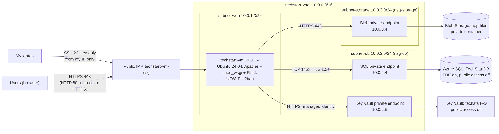
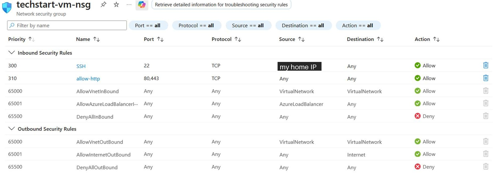
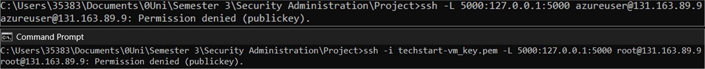
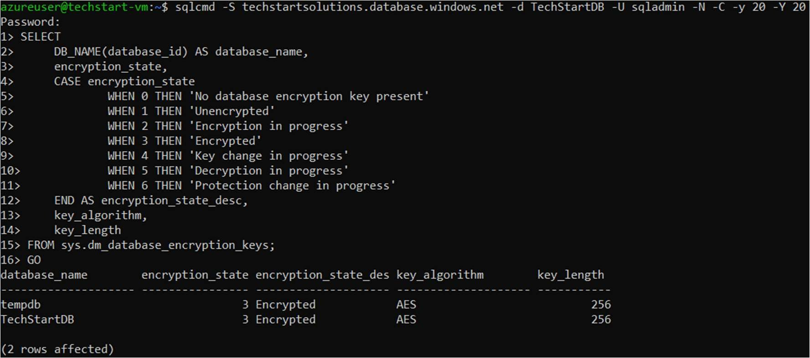
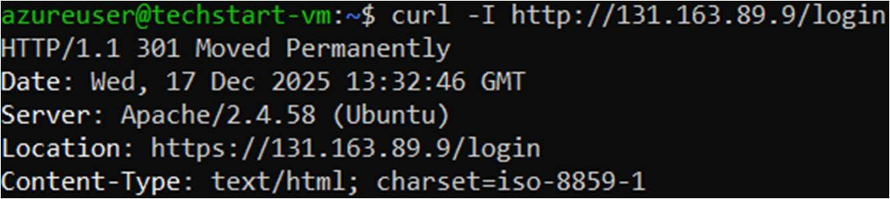
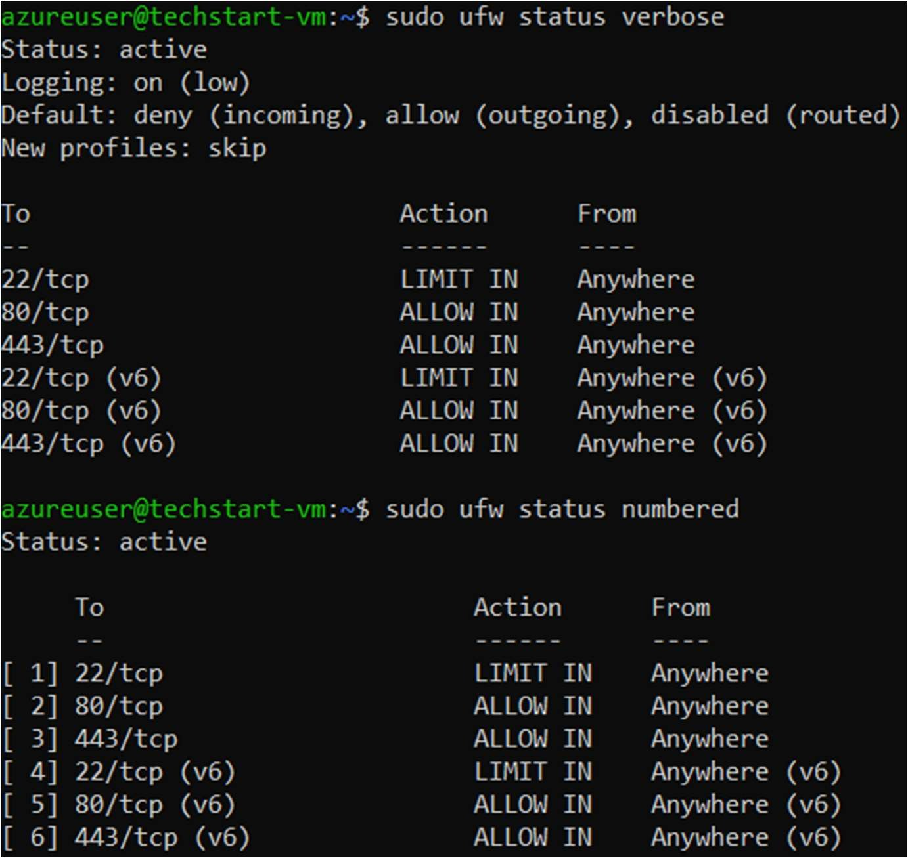
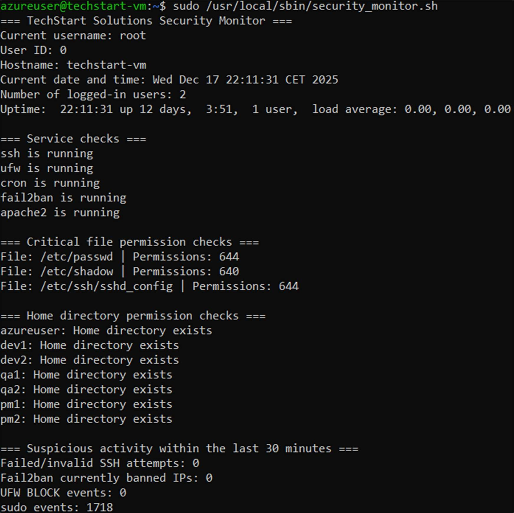

# TechStart Solutions: Securing a Web App on Azure

For this project I designed, deployed and secured the cloud infrastructure for **TechStart Solutions**, a fictional software company with six employees in three teams (Developers, QA Testers and Project Managers) that is moving to the cloud. The company's web app runs on an Ubuntu VM in Microsoft Azure, with its data in Azure SQL Database and file uploads in Azure Blob Storage.

Built as the individual project for *Security Administration* (COMP H2703) at TU Dublin. The marks were for the security work, not the app: network design, access control, encryption, hardening, logging and backups, plus the evidence that each one works.

> **About the app code:** the brief said the web app wouldn't be graded and allowed it to be generated with AI, so the Flask app in `app/` is just the workload being protected. The Azure setup, Linux hardening, config changes and both Bash scripts are my own work. Setup notes for the app are in [`DEPLOYMENT.md`](documentation/DEPLOYMENT.md).


---

## 📂 Repository Structure

```
techstartsolutions/
├── app/                         # Flask CRUD app (tickets, login, role-based actions)
│   ├── app.py
│   ├── app.wsgi
│   ├── requirements.txt
│   ├── templates/
│   └── static/
├── scripts/
│   ├── security_monitor.sh      # Security monitoring script
│   └── backup_webapp.sh         # Nightly web server backup (run by cron)
├── config/                      # The config changes I made on the VM, laid out like /etc
│   ├── etc/ssh/sshd_config
│   ├── etc/pam.d/               # common-auth, common-password
│   ├── etc/security/pwquality.conf
│   ├── etc/login.defs
│   ├── etc/apache2/sites-available/
│   ├── etc/systemd/journald.conf
│   ├── etc/logrotate.conf
│   ├── etc/logrotate.d/apache2
│   ├── crontab-root
│   └── ufw-status.txt
└── documentation/
    ├── SecurityAdministrationProjectReport.pdf
    ├── DEPLOYMENT.md            # How the app was set up on the VM
    └── images/                  # Architecture diagram and screenshots used below
```

Files in `config/` are cut down to the settings I configured, with the default comments removed. Secrets, my home IP address and the VM's public IP have been taken out.

---

## 🏗️ Architecture

<p align="center"></p>

Everything sits in one resource group, `TechStart-Solutions`, in the Norway East region. One VNet is split into three subnets, so the web server, the database and storage are kept apart. The VM is the only resource with its own public IP address, and it reaches the database, Key Vault and storage through private endpoints inside the VNet.

---

## 🔐 Security Controls

### 1. Network segmentation and access control

| NSG | Attached to | Inbound rules I added |
|-----|-------------|-----------------------|
| `techstart-vm-nsg` | VM's network interface | SSH (22) from my public IP only; HTTP and HTTPS (80, 443) from anywhere |
| `nsg-storage` | `subnet-storage` | HTTPS (443) from `subnet-web` only; deny everything else |
| `nsg-db` | `subnet-db` | SQL (1433) from the VM (10.0.1.4) to the SQL private endpoint only |

Public network access is turned off on the SQL server and on Key Vault, so they can only be reached through their private endpoints.

One thing I ran into: every NSG comes with a built-in `AllowVnetInBound` rule (priority 65000) that lets in traffic from anywhere in the VNet. It can't be edited or deleted, and it comes before the built-in `DenyAllInBound` rule. To stop the other subnets reaching storage, I had to add my own deny-all rule with a higher priority (4096).

To check it worked, I tried connecting to the VM on ports that aren't allowed (Telnet, ping), and tried HTTP and SSH against the private endpoints. All of those were blocked.

<p align="center"></p>

### 2. Strong authentication and access management

- **SSH:** key-based login only. Password login and root login are both disabled ([`sshd_config`](config/etc/ssh/sshd_config)).
- **Account lockout:** `pam_faillock` locks an account for 15 minutes after 5 failed attempts ([`common-auth`](config/etc/pam.d/common-auth)).
- **Password rules:** at least 12 characters, with a digit, an uppercase letter, a lowercase letter and a special character. No more than 3 of the same character in a row, no username or 3-character piece of it, and none of the last 5 passwords can be reused. Passwords are hashed with yescrypt ([`pwquality.conf`](config/etc/security/pwquality.conf), [`common-password`](config/etc/pam.d/common-password)).
- **Password ageing:** passwords have to be changed every 90 days, with 14 days' warning. They can't be changed again within 7 days, which stops someone cycling through 5 quick changes to get back to their old password ([`login.defs`](config/etc/login.defs)).
- I tested each rule with throwaway users (`locktest`, `passtest`, `agetest`). Testing on my own admin account would have bypassed the policies.
- **Azure RBAC:** Azure for Students accounts have limited Entra ID features, so instead of real user accounts I created a managed identity for each of the six employees and gave each team the smallest set of roles it needed. I then signed in as a member of each team to confirm what they could and couldn't do.

#### Access control matrix

| Team | Azure roles | OS access | Database | Blob Storage |
|------|-------------|-----------|----------|--------------|
| Developers | Contributor (resource group), Virtual Machine Contributor (VM), Storage Blob Data Contributor, Key Vault Secrets User | `sudo` group | `db_owner` | Read/write |
| QA Testers | Reader (resource group), Storage Blob Data Reader | `qa` group, no sudo | `db_datareader` | Read |
| Project Managers | Reader (resource group) | `pms` group, no sudo | `db_datareader` | None |

<p align="center"></p>
<p align="center"><i>Without the key, and as root even with the key, SSH is refused.</i></p>

### 3. Encryption in transit and at rest

- **Azure SQL:** Transparent Data Encryption (TDE) is on, using a service-managed key. I considered a customer-managed key in Key Vault for more control, but if that key were lost, the database would be unreadable.
- **Blob Storage:** encrypted at rest with Microsoft-managed keys, for the same reason.
- **SQL connections:** the server requires TLS 1.2 or later. Checked with `openssl s_client`, which negotiated TLSv1.2 with `ECDHE-RSA-AES256-GCM-SHA384`.
- **HTTPS:** Apache with `mod_ssl` and a self-signed certificate on port 443. I used a self-signed certificate because the site was reached by IP address, with no domain name for a certificate authority to validate. Port 80 does nothing except redirect to HTTPS ([Apache site configs](config/etc/apache2/sites-available)).

<p align="center">
  
  
</p>

### 4. System hardening and monitoring

- **UFW:** denies all incoming traffic by default and allows 80 and 443. SSH is rate limited, so one IP gets 5 connection attempts in 30 seconds before it's blocked ([`ufw-status.txt`](config/ufw-status.txt)).
- **Fail2ban:** the `sshd` jail watches for repeated failed logins and temporarily bans the source IP.
- **Automatic security updates:** `unattended-upgrades`, run daily by the `apt-daily` and `apt-daily-upgrade` systemd timers.
- **Monitoring script:** [`security_monitor.sh`](scripts/security_monitor.sh), described under Bash Scripts below.

<p align="center"></p>

### 5. Logging, backup and audit trail

- **System logging:** `rsyslog` writes the plain-text logs (`/var/log/syslog`, `/var/log/auth.log`) that Fail2ban and logrotate rely on. `systemd-journald` is set to persistent storage, capped at 200 MB (or less if free disk space drops to 200 MB), and keeps 30 days of logs ([`journald.conf`](config/etc/systemd/journald.conf)).
- **Log retention:** logrotate rotates logs weekly and keeps 4 weeks by default. Apache logs rotate daily, keep 30 days and are compressed ([`logrotate.d/apache2`](config/etc/logrotate.d/apache2)).
- **Database backups:** Azure SQL's automated backups, with 7-day point-in-time restore. I left this at the default, since longer retention would cost more.
- **Web server backups:** a root cron job runs [`backup_webapp.sh`](scripts/backup_webapp.sh) at 2am every night. It writes timestamped `.tar.gz` archives to `/var/backups/webapp` and logs to `/var/log/backup_webapp.log` ([`crontab-root`](config/crontab-root)).

### Extra measures

- **Azure Key Vault:** the SQL and storage connection strings are stored in Key Vault, not in files on the VM. The app reads them using the VM's managed identity. Public access to the vault is off, it's reached through a private endpoint, and only Developers (and the VM) have the role needed to read secrets.
- **Microsoft Defender for Cloud:** no incomplete security recommendations.

---

## 🛠️ Bash Scripts

The brief didn't allow AI for the Bash script, so both of these are written entirely by me.

**[`security_monitor.sh`](scripts/security_monitor.sh)** gives a quick security health check of the VM. It:

- prints basic host details (user, hostname, date, logged-in users, uptime)
- checks that `ssh`, `ufw`, `cron`, `fail2ban` and `apache2` are running
- checks the permissions on `/etc/passwd`, `/etc/shadow` and `/etc/ssh/sshd_config`, and on each team member's home directory
- counts failed SSH logins, Fail2ban bans, UFW blocks and sudo log entries from the last 30 minutes

On the VM it lived at `/usr/local/sbin/security_monitor.sh` and was run with `sudo`, since it needs root to query Fail2ban and read the full system journal. It can be run on demand or scheduled with cron.

<p align="center"></p>

**[`backup_webapp.sh`](scripts/backup_webapp.sh)** creates `/var/backups/webapp` if needed, then saves a timestamped, compressed archive of the web app there. Cron runs it nightly.

---

## 📄 Report

The full [project report (PDF)](documentation/SecurityAdministrationProjectReport.pdf) can be viewed in-repo. It covers the configuration, screenshots and verification for each requirement. My home IP address, subscription ID and secret keys have been blacked out.
